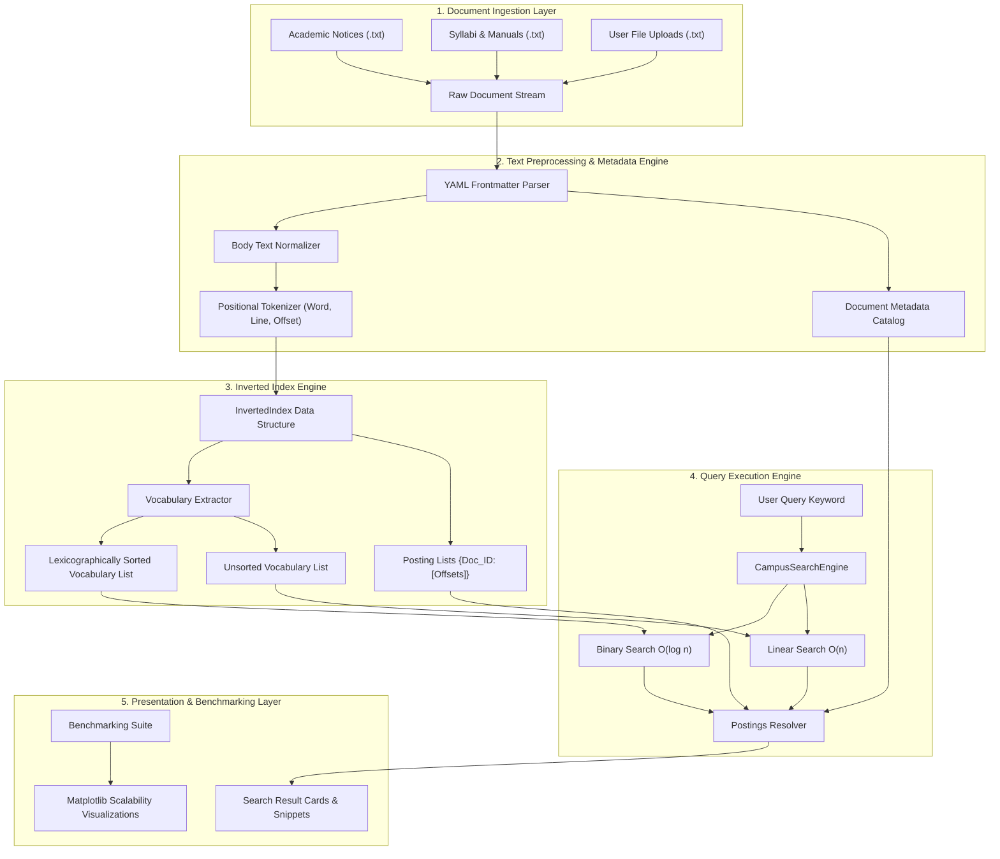

# CampusFind: System Architecture & Design Documentation

## 1. Executive Architecture Overview

**CampusFind** is an institutional document search platform designed to centralize and index academic notices, examination circulars, course syllabi, laboratory manuals, and student regulations.

The platform demonstrates the practical application of classical searching algorithms (**Linear Search $\mathcal{O}(n)$** and **Binary Search $\mathcal{O}(\log n)$**) over an in-memory **Inverted Index**.

---

## 2. System Pipeline Flowchart



---

## 3. Modular Directory Structure

```
campusfind/
│
├── app.py                      # Main Streamlit web application
├── algorithms/                 # Classical searching algorithms
│   ├── linear_search.py        # Manual sequential search with comparison counting
│   └── binary_search.py        # Manual divide-and-conquer search with pointers
│
├── indexing/                   # Index structures and ingestion coordinator
│   ├── inverted_index.py       # InvertedIndex class and JSON serialization
│   └── text_indexer.py         # Ingestion, metadata parsing, and cataloging
│
├── search/                     # High-level search coordination
│   └── search_engine.py        # CampusSearchEngine, filtering, and snippet generation
│
├── benchmarking/               # Empirical performance testing
│   └── benchmark.py            # Profiling engine across N = 100 to 10,000
│
├── components/                 # Streamlit UI modular components
│   ├── dashboard.py            # Homepage overview, KPI metrics, category lists
│   ├── search_results.py       # Result cards, context snippets, and traces
│   └── charts.py               # 4-panel publication-ready Matplotlib figures
│
├── utils/                      # Helper utilities
│   └── text_processing.py      # Normalization, tokenization, frontmatter parser
│
├── data/
│   ├── documents/              # 21 realistic institutional sample documents
│   └── index.json              # Precomputed Inverted Index JSON dump
│
├── docs/                       # Project documentation
│   ├── architecture.md         # System architecture and pipeline flowcharts
│   ├── algorithms.md           # Theoretical analysis, complexity proofs, dry-runs
│   └── viva_questions.md       # 35 viva voce preparation questions & answers
│
├── tests/                      # Automated unit test suite
│   ├── test_linear_search.py   # Bounds, edge cases, comparisons for Linear Search
│   ├── test_binary_search.py   # Bounds, divisions, edge cases for Binary Search
│   └── test_indexing.py        # Tokenizer, inverted index, and search engine tests
│
├── requirements.txt            # Project dependencies
├── README.md                   # Installation, execution, and user guide
└── .gitignore                  # Git ignore rules
```

---

## 4. Inverted Index Data Schema

An **Inverted Index** is the industry-standard data structure powering modern information retrieval systems. It inverts the conventional document-to-words mapping into a word-to-documents dictionary.

### Inverted Index JSON Schema
```json
{
  "examination": {
    "doc_01_exam_schedule.txt": [12, 45],
    "doc_02_admit_card_circular.txt": [8],
    "doc_03_revaluation_rules.txt": [14, 82]
  },
  "attendance": {
    "doc_02_admit_card_circular.txt": [34],
    "doc_05_attendance_policy.txt": [9, 27, 65]
  }
}
```

### Inverted Index vs. Sorted Vocabulary
- **Inverted Index:** A dictionary mapping words to document postings and positional offsets. Provides $\mathcal{O}(1)$ average hash-table retrieval of document references once the word is resolved.
- **Sorted Vocabulary:** An array of unique vocabulary terms sorted alphabetically: `["academic", "admission", "attendance", "calendar", ...]`. Essential for executing **Binary Search** in $\mathcal{O}(\log n)$ time.

---

## 5. Algorithmic Complexity Profile

| Component | Operation | Time Complexity | Auxiliary Space |
| :--- | :--- | :--- | :--- |
| **Tokenization** | Parsing $M$ document tokens | $\mathcal{O}(M)$ | $\mathcal{O}(M)$ |
| **Indexing** | Inserting tokens into Inverted Index | $\mathcal{O}(M)$ | $\mathcal{O}(M)$ |
| **Vocabulary Sorting** | Sorting $V$ unique terms | $\mathcal{O}(V \log V)$ | $\mathcal{O}(V)$ |
| **Linear Search** | Querying unsorted or sorted array | $\mathcal{O}(n)$ | $\mathcal{O}(1)$ |
| **Binary Search** | Querying strictly sorted array | $\mathcal{O}(\log_2 n)$ | $\mathcal{O}(1)$ iterative |
| **Snippet Generation**| Locating window in document string | $\mathcal{O}(L)$ | $\mathcal{O}(1)$ |

